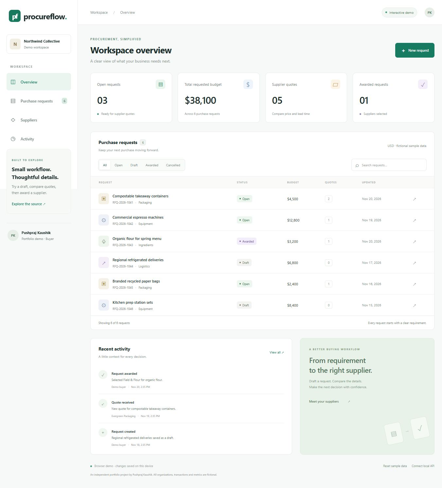
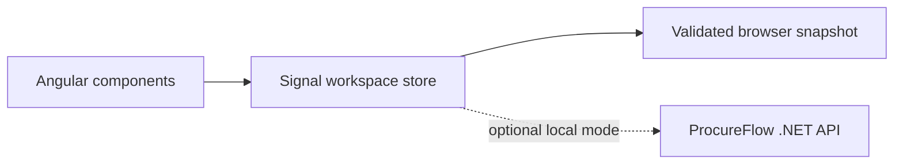

# ProcureFlow Console

A focused Angular procurement workspace: draft a requirement, compare supplier quotes and record an award.

[](https://github.com/erpushprajkaushik/procureflow-console/actions/workflows/ci.yml)

[**Open the interactive demo →**](https://erpushprajkaushik.github.io/procureflow-console/)



**Independent portfolio sample by Pushpraj Kaushik.** All organizations, transactions, ratings and metrics are fictional. No client source code or client data is included.

## Explore in two minutes

1. Open **Compostable takeaway containers** and compare the two quotes.
2. Select a supplier. The award, metrics and activity log update together.
3. Create a **New request**, save the draft, open it and publish it.
4. Search, filter by status, reload the page, or use **Reset sample data** to start again.

## Run locally

Requires Node.js 22.22.3+ (22.x) and npm. Tested locally with Node 22.23.2.

```sh
npm ci
npm start
```

Open `http://localhost:4200`. There is no account, payment setup, backend hosting or cloud database requirement.

```sh
npm test
npm run build
```

The 20 Vitest cases exercise validation, legal/illegal transitions, stale decisions and corrupt browser storage. The production build uses Angular's strict template checks. CI repeats the tests and build on a standard GitHub-hosted runner.

## Where the data lives

| Mode                                    | Persistence                                      | Purpose                                                  |
| --------------------------------------- | ------------------------------------------------ | -------------------------------------------------------- |
| Browser demo (default and GitHub Pages) | Versioned `localStorage` on the visitor's device | Try the complete buyer flow without a server             |
| Local API                               | SQLite in the companion .NET app                 | Exercise actual HTTP, JWT policies and server validation |

Browser mode makes no API calls. Data is device-local, not shared across visitors. Reset restores fictional samples only. If storage is unavailable the workspace still runs for the current session.

### Connect the .NET API

Run [procureflow-api](https://github.com/erpushprajkaushik/procureflow-api) locally on `http://localhost:5175` in Development mode. Run this Angular app locally too, then click **Connect local API** in the footer. A one-hour demo buyer JWT is kept in memory and never stored in browser storage. Returning to browser mode restores its independent workspace. No client credentials are used.

Local API integration is intended for local development; the public HTTPS demo remains in browser mode. The sample console loads at most 100 API requests and reports larger datasets explicitly. Supplier quote submission is exposed through the API, while this UI focuses on the buyer workflow.

## Design and architecture

- Standalone Angular 22 components, signals/computed state and lazy-free hash routing for static hosting.
- A responsive workspace with request filters, validated creation, quote comparison, supplier directory and decision log.
- `core/domain.ts`: framework-independent validation and transition rules.
- `core/workspace-store.ts`: persistence, API transport and user-facing failures.
- `core/seed.ts`: original fictional sample data.
- `workspace/`: UI, including dialogs and narrow-screen layouts.
- Integer cents for money; versions travel with server write commands.



### Free static hosting

The Pages workflow builds with `--base-href /procureflow-console/` and publishes only the static `dist/procureflow-console/browser` files. The .NET API and SQLite database are **not** hosted by Pages. No external analytics, paid assets or paid hosting services are used.

This is a reviewable learning/portfolio sample, not a multi-tenant procurement service. A production product would need a real identity provider, accessible end-to-end testing, a paged API UI and operational controls.

MIT licensed. See [LICENSE](LICENSE).
